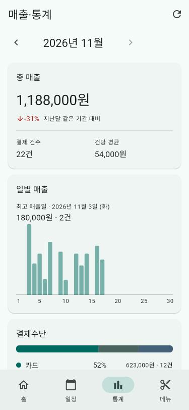
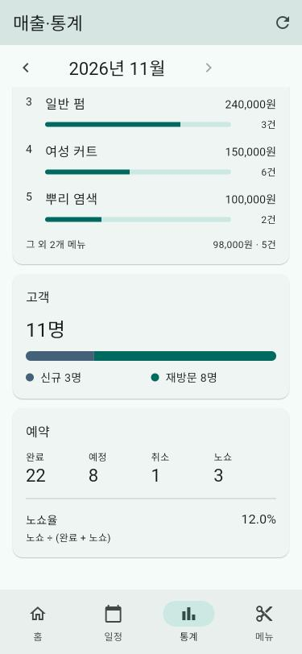
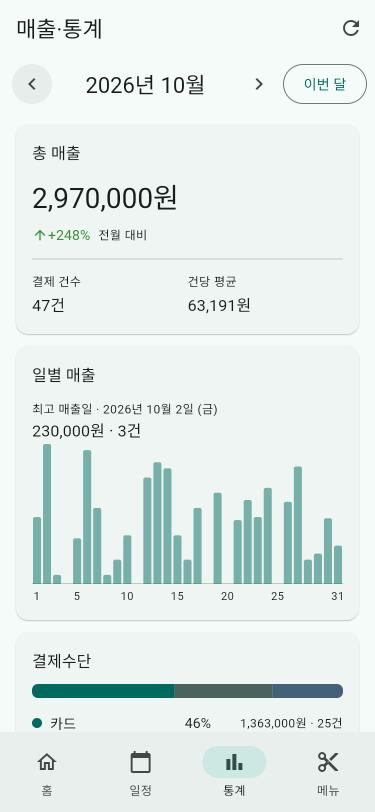
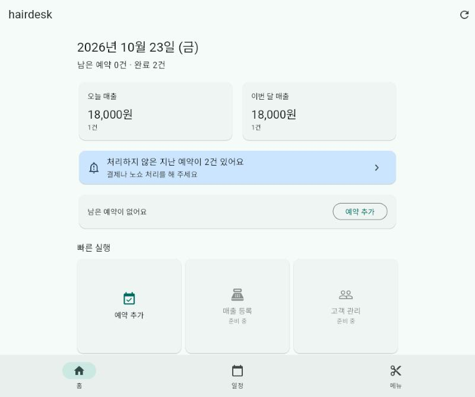
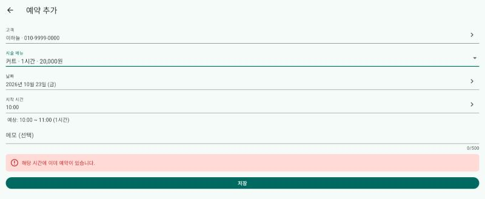
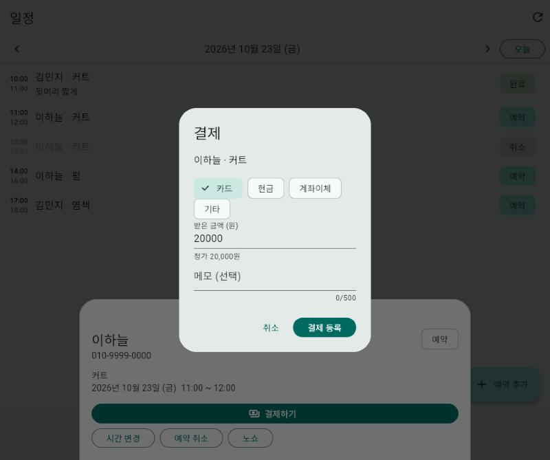

# hairdesk

**미용사를 위한 예약·고객·매출 관리 서비스** (개발 중)

비슷한 앱은 이미 있습니다. 예약(네이버·카카오헤어 제휴), 매출 관리, 고객 메모 기능도 갖추고 있습니다. 하지만 기능이 많아도 쓰기에는 불편했고, hairdesk는 이 세 가지를 **더 편하게** 한 앱에서 다루는 것을 목표로 합니다.
처음에는 복잡도를 줄이려고 1인 미용사 기준으로 설계했고, 지금은 미용사(직원)가 여러 명이어도 쓸 수 있게 확장하고 있습니다. 재취업 포트폴리오를 겸하면서 실제 출시를 목표로 만들고 있습니다.

> **현재 상태** 핵심 업무 흐름 "예약 → 결제 → 완료"와 월별 통계가 앱 화면까지 동작합니다. 인증·배포·모바일 빌드는 아직입니다.
> 자세한 진행 현황과 로드맵은 [`docs/PROGRESS.md`](docs/PROGRESS.md)를 보세요.

## 화면

<table>
  <tr>
    <td align="center"><br><sub>통계 · 요약과 일별 그래프</sub></td>
    <td align="center"><br><sub>통계 · 고객과 예약 현황</sub></td>
    <td align="center"><br><sub>통계 · 지난 달 보기</sub></td>
  </tr>
</table>

| 홈 | 예약 겹침 안내 | 결제 |
|---|---|---|
|  |  |  |

화면 속 이름과 전화번호는 모두 샘플 데이터입니다.

## 주요 기능

**동작함**
- **홈**: 오늘 요약, 오늘·이번 달 매출, 다음 예약, 결제·노쇼 처리를 깜빡한 지난 예약 알림
- **일정**: 날짜별 예약 보기, 예약 등록(고객 검색·신규 등록, 메뉴·시간 선택), 시간이 겹치면 등록 불가
- **예약 관리**: 결제(예약이 자동으로 완료됨), 시간 변경, 취소, 노쇼
- **통계**: 월 단위 이동, 전월 대비, 일별 매출 그래프, 결제수단 비중, 메뉴별 순위, 신규/재방문 고객, 노쇼율
- **시술 메뉴**: 등록·수정, 판매 중지(삭제 대신, 과거 매출 보존)

**준비 중**: 고객 관리 화면, 예약 없이 온 손님 매출 등록, 영업시간·휴무일, 매출 환불, 로그인

## 기술 스택

| 영역 | 사용 기술 |
|---|---|
| 백엔드 | Java 21, Spring Boot 4.1, Spring Data JPA, Gradle 9 |
| 데이터베이스 | PostgreSQL 17, Flyway(마이그레이션) |
| 테스트 | JUnit 5, Testcontainers |
| API 문서 | springdoc-openapi (Swagger UI) |
| 앱 | Flutter (현재 Chrome 웹, 이후 모바일) |
| 실행 환경 | Docker Compose |

## 설계에서 신경 쓴 점

- **예약 시간 겹침은 DB가 최종으로 막습니다.** 서비스에서 먼저 확인해 친절한 메시지를 주고, 거의 동시에 들어온 요청은 PostgreSQL EXCLUDE 제약이 막습니다. → [ADR 0003](docs/adr/0003-reservation-overlap-prevention.md)
- **겹침은 같은 담당자끼리만 막습니다.** 가족 손님이 서로 다른 미용사에게 같은 시간에 예약할 수 있어야 해서, 제약에 `staff_id`를 넣었습니다. → [ADR 0010](docs/adr/0010-staff.md)
- **매출에 "그때의 가격"을 복사해 둡니다.** 메뉴 가격이 나중에 올라도 과거 매출이 바뀌지 않습니다. 같은 예약에 결제가 두 번 기록되지도 않습니다. → [ADR 0004](docs/adr/0004-sales-records.md)
- **통계의 전월 대비는 같은 기간끼리 비교합니다.** 달 초마다 "-70%"로 보이는 일을 막습니다. → [ADR 0007](docs/adr/0007-statistics-display-rules.md)
- **차트는 외부 패키지 없이 기본 위젯으로** 만들어 코드를 읽고 이해할 수 있게 했습니다. → [ADR 0008](docs/adr/0008-charts-with-plain-widgets.md)

설계 결정은 모두 [`docs/adr/`](docs/adr/README.md)에 이유와 함께 기록합니다(현재 11개).

## 구조

```
hairdesk/
├── backend/   Spring Boot API
│   └── src/main/java/com/salonapp/
│       ├── customer/  menu/  reservation/  sales/  stats/   도메인별 패키지
│       └── common/                                          공통(예외, 시간, 설정, 개발용 샘플 데이터)
├── app/       Flutter 앱
│   └── lib/
│       ├── core/       API 클라이언트, 서울 시각 변환, 포맷
│       └── features/   기능별 폴더 (home, reservation, customer, menu, sales, stats)
├── docs/      PROGRESS.md(진행 현황) · adr/(설계 결정) · blog/(개발 일지 초안)
└── CLAUDE.md  개발 규칙
```

## 시작하기

준비물: JDK 21, Docker Desktop, Flutter SDK

```bash
# 1) 백엔드 (backend/ 에서)
./gradlew bootRun
```

- PostgreSQL 컨테이너를 자동으로 띄우고, **DB가 비어 있으면 샘플 데이터(메뉴·고객·예약·매출)를 자동으로 넣습니다.**
- 헬스체크 http://localhost:8080/actuator/health · API 문서 http://localhost:8080/swagger-ui.html

```bash
# 2) 앱 (app/ 에서, 백엔드를 먼저 켜 둘 것)
flutter run -d chrome
```

```bash
# 테스트
./gradlew test        # backend/  (135개, Docker 필요)
flutter test          # app/      (274개)
```

### 폰으로 보기 (같은 와이파이)

PC에서 백엔드(`./gradlew bootRun`)를 켠 상태로, 저장소 맨 위 폴더에서 다음을 실행합니다.

```powershell
powershell -ExecutionPolicy Bypass -File scripts\phone-preview.ps1
```

- PC의 와이파이 주소를 찾아 그 주소를 서버 주소로 박아 앱을 빌드하고, 폰이 열 수 있게 띄웁니다. 화면에 나오는 주소(`http://192.168.x.x:5173`)를 폰 브라우저에서 엽니다.
- **같은 와이파이에서만** 됩니다. 개발 DB 포트(5432)도 같은 네트워크에 열려 있으니 **믿을 수 있는 네트워크(집)에서만** 쓰세요. 이유와 주의점은 [ADR 0009](docs/adr/0009-phone-preview-over-lan.md)에 있습니다.
- Windows 방화벽 창이 뜨면 "개인 네트워크"만 허용하세요.

**폰에서 앱 화면(하단 탭)은 뜨는데 계속 로딩만 돈다면** (서버 8080에만 못 닿는 경우)
1. **PC의 네트워크 프로필이 "공용"인지** 확인합니다. 집 네트워크는 "개인"이어야 합니다. (설정 → 네트워크 및 인터넷 → 이더넷 → 네트워크 프로필 유형)
2. 폰 브라우저에서 `http://<PC 주소>:8080/api/menus`가 열리는지 봅니다. 한글이 섞인 JSON이 보이면 서버까지 닿는 것입니다.
3. 그래도 막히면 방화벽에 `java.exe`를 **차단**하는 규칙이 있을 수 있습니다. (Java가 처음 네트워크를 쓸 때 뜬 경고 창을 취소하면 자동으로 생깁니다.) 방화벽은 **차단 규칙이 허용 규칙보다 우선**하므로, 포트를 허용해 놓아도 소용이 없습니다. 관리자 PowerShell에서 확인하세요.
   ```powershell
   netsh advfirewall firewall show rule name=all dir=in verbose | findstr /i "java Block"
   ```
   일반 PowerShell의 `Get-NetFirewallRule`은 이 규칙들을 못 보여줄 수 있어서 `netsh`를 씁니다.

개발용 DB를 처음부터 다시 채우려면 `backend/`에서 `docker compose down -v` 후 다시 `bootRun`을 실행합니다. **개발 DB의 모든 데이터가 지워집니다.**

## 개발 방식

- 개발자가 AI 없이도 이해하고 유지보수할 수 있어야 한다는 원칙으로, 작게 나눠 만듭니다.
- 기능 하나는 **설계 설명 → 구현 → 테스트 → 커밋** 순서로 진행하고, 중요한 결정은 ADR로 남깁니다.
- 규칙 전체는 [`CLAUDE.md`](CLAUDE.md), 개발 일지 초안은 [`docs/blog/`](docs/blog/README.md)에 있습니다.

## 라이선스

미정
