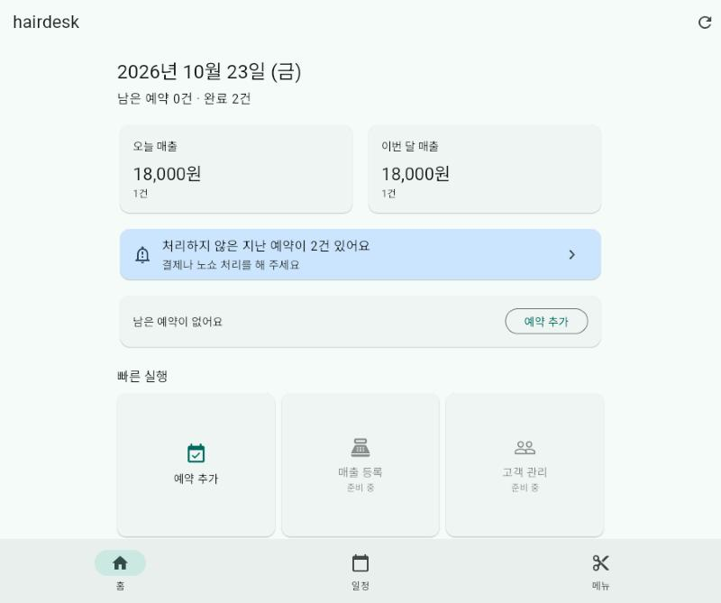
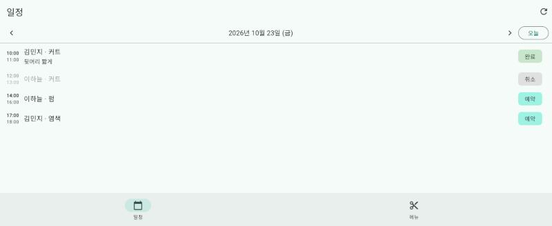
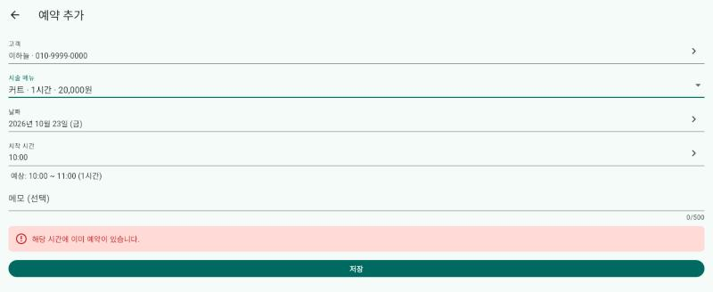
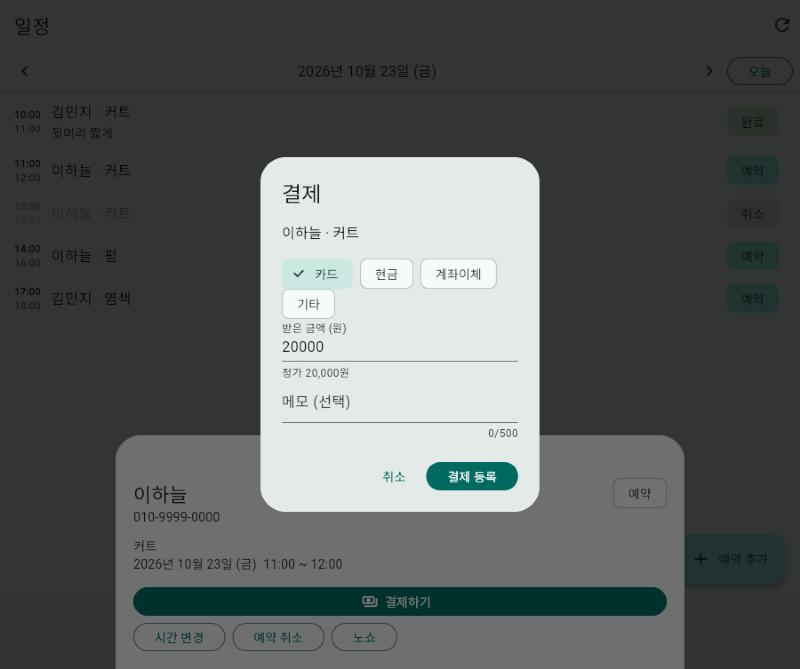
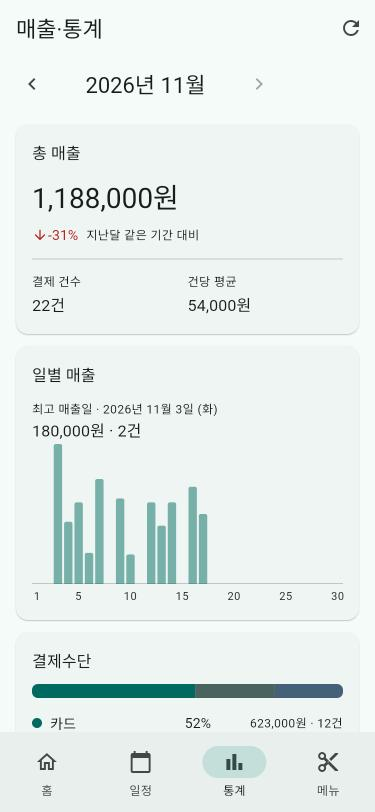
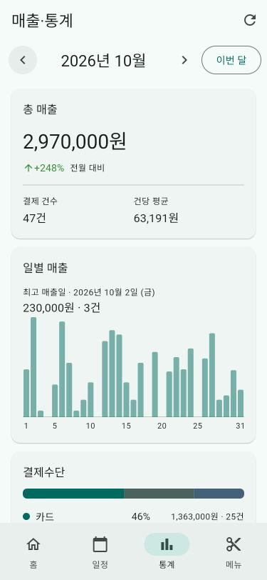

# [hairdesk 개발일지 프롤로그] 지금까지와 앞으로, 전체 지도

> **요약** 예약·고객·매출을 한 앱에서 관리하는 서비스를 만들고 있다. 백엔드(Spring Boot) 핵심 API와 Flutter 앱의 주요 화면(홈·일정·예약·결제·통계)까지 동작한다.
> 이 글은 지금까지의 진행 상황, 기억에 남는 설계 결정, 테스트로 잡은 문제들, 앞으로의 계획을 정리한 개발 일지다.

<!-- 블로그에 올리기 전 확인: 숫자는 2026-11-22 기준(PROGRESS.md)입니다. 발행할 때 다시 맞추고, "AI와 일하는 방식" 절은 공개 여부를 직접 결정하세요. -->

## 1. 어떤 서비스인가

미용사를 위한 예약·고객·매출 관리 서비스다. 비슷한 앱은 이미 있다. 예약은 네이버나 카카오헤어 제휴로 받고, 매출 관리랑 고객 메모 기능도 다 있다. 그런데 기능이 많아도 쓰기에는 불편했다. 그래서 **더 편하게 쓸 수 있는 앱**을 목표로 직접 만들고 있다.
처음에는 복잡도를 줄이려고 1인 미용사만 대상으로 했다. 지금은 미용사가 여러 명이어도 쓸 수 있게 넓혀 가는 중이다. (저장소 이름 `hairdesk`)

- 예약: 날짜별 일정, 시간이 겹치면 예약 불가, 취소·노쇼 처리
- 고객: 이름·연락처 검색, 메모
- 매출: 결제 등록(예약 완료와 연결), 월별 통계

재취업 포트폴리오로 쓰면서 실제 출시까지 가는 게 목표다.

## 2. 개발 원칙

제일 중요하게 둔 원칙은 하나다.

> **개발자(나)가 AI 없이도 이해하고 유지보수할 수 있어야 한다.**

그래서 이렇게 일한다.

- **기능 하나 = 설계 설명 → 구현 → 테스트 → 커밋.** 작게 나눠서 매번 "무엇을 왜 했는지"를 설명받는다.
- 영리한 코드보다 읽히는 코드. 마법 같은 추상화는 쓰지 않는다.
- 중요한 설계 결정은 **ADR**(Architecture Decision Record)로 남긴다. 지금까지 11개다.

## 3. 기술 스택

| 영역 | 선택 |
|---|---|
| 백엔드 | Java 21, Spring Boot 4.1, Spring Data JPA, PostgreSQL, Flyway |
| 테스트 | JUnit 5, Testcontainers |
| API 문서 | springdoc-openapi (Swagger UI) |
| 클라이언트 | Flutter (현재 Chrome 웹, 이후 모바일) |
| 실행 | Docker Compose |

## 4. 지금까지 (9월 29일 ~ 11월 22일, 약 8주, 커밋 48개)

| 시기 | 한 일 |
|---|---|
| 9월 말 | 프로젝트 규칙과 기술 스택 결정, 백엔드 뼈대, 메뉴·고객·**예약·매출·통계** API |
| 10월 말 | Flutter 앱 시작. 메뉴, 일정, 예약 등록, 예약 상세(결제), **홈** 화면 |
| 11월 중순 | **통계 화면**을 네 개 층으로 나눠 완성 (데이터 → 계산 → 화면 부품 → 조립) |
| 11월 하순 | **직원(담당자) 기능**: 직원 API, 예약·매출에 담당자 연결, 직원별 예약 겹침 규칙, 앱의 직원 화면과 담당자 표시 |

지금 규모는 백엔드 API 33개, 테스트 409개(백엔드 135 + 앱 274)다. 정확한 현황은 저장소의 [`docs/PROGRESS.md`](../PROGRESS.md)에 계속 갱신한다.

### 화면

| 홈 | 일정 |
|---|---|
|  |  |

홈에는 오늘 매출, 다음 예약, 그리고 **시간이 지났는데 아직 결제·노쇼 처리를 안 한 예약 알림**을 넣었다. 바쁘다 보면 처리를 깜빡하기 쉽고, 그러면 매출이 장부에서 빠지기 때문이다.

## 5. 기억에 남는 설계 결정 3가지

### ① 예약 시간 겹침은 "DB가" 막는다

"저장하기 전에 겹치는 예약이 있는지 조회하고, 없으면 저장"하는 방식은 거의 동시에 들어온 두 요청이 **둘 다 조회를 통과**할 수 있다. 그래서 PostgreSQL의 EXCLUDE 제약을 최종 방어선으로 뒀다.

```sql
CONSTRAINT ex_reservation_no_overlap_per_staff
    EXCLUDE USING gist (staff_id WITH =, tstzrange(start_at, end_at) WITH &&)
    WHERE (status IN ('BOOKED', 'COMPLETED'))
```

- 서비스에서도 먼저 확인해서 "해당 시간에 이미 예약이 있습니다"라는 친절한 메시지를 준다. DB 제약은 어떤 경로로 들어와도 겹침을 막는 마지막 안전장치다.
- 처음에는 시간 겹침만 막았고, 직원 기능을 넣으면서 `staff_id WITH =`를 더했다. 같은 담당자의 예약만 겹치지 않으면 되고, 가족 손님이 서로 다른 미용사에게 같은 시간에 예약할 수도 있어야 해서다.
- 시간 구간은 `[시작, 종료)`라서 14:00~15:00 예약 바로 뒤에 15:00 시작 예약은 가능하다.
- 취소·노쇼는 제약에서 제외해서 같은 시간에 다시 예약할 수 있다.
- "서비스 확인을 우회해도 DB가 막는지"를 테스트로 확인한다.

| 예약 등록 중 겹침 |
|---|
|  |

앱은 서버가 준 메시지를 그대로 보여준다. 규칙을 화면과 서버 두 곳에 두면 어긋나기 때문에 겹침 판단은 서버에만 있다.

### ② 매출에는 "그때의 가격"을 복사해 둔다

메뉴 가격은 나중에 오른다. 매출이 메뉴를 참조만 하면 "작년 커트 매출"이 올해 가격으로 바뀐다. 그래서 결제 시점의 **메뉴 이름과 정가를 매출 행에 복사**(스냅샷)하고, 실제로 받은 금액은 따로 저장한다. 할인액은 `정가 - 받은 금액`으로 계산한다.

또 하나, "결제를 등록하면 예약이 자동으로 완료"되게 했다. 같은 예약에 결제가 두 번 등록되지 않도록 DB에 UNIQUE 제약도 뒀다(겹침 방지와 같은 사고방식이다).

| 결제 창 |
|---|
|  |

### ③ 통계의 "전월 대비"는 같은 기간끼리 비교한다

오늘이 17일인데 이번 달 1~17일 매출을 지난달 **한 달 전체**와 비교하면 매달 초마다 "-70%"처럼 보인다. 그래서 이렇게 정했다.

- 진행 중인 이번 달: 지난달의 **같은 날짜까지**와 비교 ("지난달 같은 기간 대비")
- 끝난 달: 직전 달 **전체**와 비교 ("전월 대비")
- 비교할 매출이 0원이면 퍼센트를 만들지 않고 "비교할 매출 없음"으로 표시 (+∞%도 +100%도 거짓이라서)
- 결제수단 비율은 각각 반올림하면 합이 99나 101이 될 수 있어서, 합이 항상 100이 되도록 "최대 잔여법"으로 나눠 준다.

이 규칙들은 화면 코드와 분리한 순수 계산 함수로 두고, 경계값(2월 말, 해가 바뀌는 달 등)까지 테스트했다. 이유는 ADR에 남겼다.

| 통계 (이번 달) | 통계 (지난 달) |
|---|---|
|  |  |

일별 막대 그래프는 외부 차트 패키지 없이 기본 위젯만으로 만들었다. 막대가 최대 31개고 필요한 기능이 "누르면 그날 값 보기"뿐이라, 패키지를 들이는 것보다 코드를 읽고 이해할 수 있는 쪽이 낫다고 판단했다.

## 6. 테스트와 눈으로 확인하며 잡은 문제들

테스트가 다 통과해도 놓치는 게 있었다. 기록해 둔다.

- **보이지 않는 막대**: 결제수단 비중 막대가 화면에 안 나왔다. 내용 없는 위젯이 `Row` 기본 정렬에서 **높이가 0**이 되기 때문이다. 테스트는 막대의 *너비*만 확인해서 통과하고 있었고, 폰 크기로 직접 열어 보고서야 발견했다. 지금은 높이도 검증한다.
- **폰에서 잘리는 글자**: "준비 중" 글자가 좁은 화면에서 잘렸다. 칸 높이를 폭 비율로 정해서 생긴 문제였다.
- **에러 메시지 소실**: 요청 여러 개를 한꺼번에 기다릴 때 Dart의 레코드 `.wait`는 에러를 한 겹 감싸서 던진다. 그래서 서버가 준 한글 에러 메시지가 사라졌다. 테스트가 잡았고 `Future.wait`로 바꿨다.
- **정렬은 안정적이지 않다**: "같은 금액이면 원래 순서를 지킨다"고 주석을 썼는데 Dart의 `List.sort`는 그걸 보장하지 않았다. 코드를 쓰다 주석이 틀린 걸 발견해서 비교 기준을 추가했다.

교훈은 하나다. **시각적인 부분은 폰 크기로 직접 열어서 눈으로 확인한다.**

## 7. AI와 일하는 방식

이 프로젝트는 AI 코딩 도구(Claude Code)와 같이 하고 있다. 중요한 건 "맡겨 놓고 결과만 받지 않는다"는 것이다.

- 기능마다 **설계를 먼저 설명**받고, 선택지와 이유를 ADR로 남긴다.
- 큰 기능은 **층별로 쪼개서 한 층씩** 만들고, 각 층마다 멈춰서 확인한다.
- 코드에는 "무엇"이 아니라 **"왜"** 를 한국어 주석으로 단다.
- 위험한 작업(개발 DB 삭제 등)은 실행 전에 확인을 받는다.

AI가 만든 코드를 내가 설명할 수 있어야 한다는 원칙이 이 방식의 이유다.

## 8. 앞으로

| 우선순위 | 할 일 |
|---|---|
| 다음 | 고객 관리 화면, 매출 등록(예약 없이 온 손님) 화면, **영업시간·휴무일** 규칙 |
| 그다음 | 매출 환불·정정 이력, 개인정보 파기 정책, 접근성·다크 모드 |
| 출시 준비 | 로그인(인증), 배포(서버·DB·HTTPS·백업), 모바일 앱 빌드, README |

현재 진행률은 포트폴리오로 보여줄 수 있는 수준까지 약 60%, 실제 출시까지는 약 35~40%로 보고 있다(체감 추정이다). 인증과 배포가 아직 거의 손도 못 댄 영역이라 출시까지는 갈 길이 남았다.

## 마무리

백엔드부터 천천히 만들고, 앱은 화면 하나씩, 큰 화면은 층 하나씩 쌓고 있다. 다음 글(챕터 1)부터는 시간순으로 돌아가서, **무엇을 왜 이 스택으로 만들기로 했는지**부터 차근차근 풀어 본다.

전체 진행 현황과 설계 결정 기록은 저장소의 `docs/PROGRESS.md`, `docs/adr/`에서 볼 수 있다.
